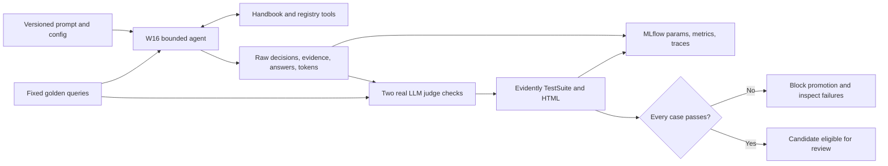

# Track B — Agentic AI MLOps

This project runs the actual W16 cross-source verification loop against a local language model, tracks three prompt/configuration versions in MLflow, and applies two real LLM-as-a-judge checks through Evidently's `BinaryClassificationPromptTemplate` and `TestSuite`. The complete W15/W16 source is vendored under [assistant](assistant/README.md); no sibling checkout is needed.

## Environment and reproduction

Python 3.12 and [uv](https://docs.astral.sh/uv/) are required. From this directory, `uv sync --locked` recreates the committed environment. MLflow 2.22.2 needs SQLAlchemy 2.0.41: an actual run with SQLAlchemy 2.1 failed importing a removed pool class. Evidently 0.6.7 is pinned because this assignment explicitly uses its legacy `TestSuite` and binary judge API. We install the minimal package plus OpenAI directly; heavyweight text-embedding/GPU training extras are unnecessary for a remote/local chat-completions judge.

```bash
uv sync --locked
uv run pytest -q
uv run ruff check experiment.py tests
```

Install [Ollama](https://ollama.com/) separately, start its local server, and pull the evaluation model:

```bash
ollama pull qwen2.5:1.5b
ollama pull qwen2.5:3b
uv run python experiment.py --version v1 --max-steps 2 --top-k 1 --judge-model qwen2.5:3b --overwrite
uv run python experiment.py --version v2 --max-steps 6 --top-k 2 --judge-model qwen2.5:3b --overwrite
uv run python experiment.py --version v3 --max-steps 8 --top-k 2 --model qwen2.5:3b --judge-model qwen2.5:3b --overwrite
uv run mlflow ui --backend-store-uri sqlite:///mlflow.db --host 127.0.0.1 --port 5001
```

`--overwrite` explicitly replaces committed example output files in your working copy; each execution creates a new MLflow run. Omit it when writing a new version directory. The three versions deliberately contain failures; a successful process exit means the experiment ran, **not** that its candidate passed promotion. Read `summary.json` → `promotion.promote`, which fails closed unless all six cases satisfy the expected behavior, both judges, and complete reported token accounting.

Run the full assistant API/UI separately with `cd assistant && uv sync --locked`, then follow its README. The outer environment only needs the agent/evaluation modules. Both lockfiles are committed. `--base-url`, `--model`, `--judge-model`, and `OPENAI_API_KEY` support an explicitly configured OpenAI-compatible provider; the recorded runs use local Ollama only. The fixture questions and policies are synthetic.

## Experiment tracking strategy

The fixed [golden set](golden.json) contains six authored reference cases: current annual leave versus an archived conflict, carryover, remote work, contractor scope, a single-source policy, and an injected registry outage. The canonical factual values are independently checked against the current authoritative fixture. These references are project-authored expectations, not responses approved by an external human reviewer.

- `prompt_v1`: short-path baseline, two iterations, top-k 1. Actual traces exposed a budget too small for two searches plus a finish, missing citations, and a premature single-source answer.
- `prompt_v2`: six iterations, top-k 2; explicitly requires two relevant publishers and exact note IDs. Observed traces still nested clarification inside `arguments`, invented `.id` citation suffixes, mixed carryover with entitlement, and retried unavailable evidence.
- `prompt_v3`: eight iterations, a larger Qwen 2.5 3B model, and concrete action-schema examples. It distinguishes missing evidence from user ambiguity, puts clarification/reason fields at the correct level, and requires both citations to address the same fact key. Its changes respond to those v2 traces; the loop still chooses its next action dynamically.

Every run logs prompt/configuration hashes, source hash, full raw tool results, raw model decisions, failure events, terminal status, iteration count, response, provider-reported agent and judge tokens, latency, task completion, tool correctness, judge pass percentage, and promotion. Invalid tool attempts count against correctness. Missing decision summaries are counted in `decision_reason_coverage`; they are never invented after the fact. Judge parse failures retain already-consumed usage and raw responses. Unknown usage is explicitly incomplete and blocks promotion. The reported cost is `null`: local hardware/electricity cost was not measured, so token totals are not represented as dollar savings.

Eight focused outer-project tests pass; an independent fresh-directory `uv sync --locked` and the then-current seven-test suite also passed before the additional malformed-action regression test was added.

The exported comparison and the interpretation of specific failures are in [reports/ANALYSIS.md](reports/ANALYSIS.md). Full raw traces and judge verdicts are under each `reports/v*` directory and logged as MLflow artifacts. Local SQLite and model caches are excluded from Git; portable reports carry run IDs and can be inspected without the database.

## Monitoring and regression strategy

The reference is the same approved-in-code fixture set for every version; current means newly generated responses from that candidate. Evidently's binary template constructs and parses a real model call for (1) reference-based correctness and (2) support by observed evidence, including appropriate uncertainty on failures. Only the candidate answer is placed inside the classification markers; reference/evidence appear in separate background fields. The transport uses the OpenAI client against Ollama, allowing raw verdicts and token accounting to be retained. No deterministic string-match result is presented as an LLM judge.

An actual Evidently `TestSuite` checks the minimum correctness, groundedness, completion, and accounting value across cases. It writes standalone HTML and JSON, and MLflow records both the suite outcome and `pct_tests_passed` (the percentage of individual LLM checks passing). Promotion additionally requires every case to pass all checks; a failed suite cannot be promoted. A unit test injects a failed correctness/completion row and verifies that the real suite fails.

The final common judge is Qwen 2.5 3B; v1/v2 agents use 1.5B and v3 uses 3B. Generation and judging share a model family (and v3 shares exact weights), creating correlated errors; fixed temperature does not remove model bias. The report explicitly compares judge claims with the raw answers and canonical facts. These six cases were used for prompt development, so they are not held out and cannot establish production reliability. Deployment needs a larger independent judge, reviewed labels, broader held-out tests, and a separate approved release process. No Airflow bonus is claimed.



See the official [Evidently LLM evaluation tutorial](https://docs-old.evidentlyai.com/tutorials-and-examples/tutorial-llm) for the pinned API, and [MLflow tracking documentation](https://mlflow.org/docs/2.22.2/tracking.html) for the underlying experiment/artifact model.
