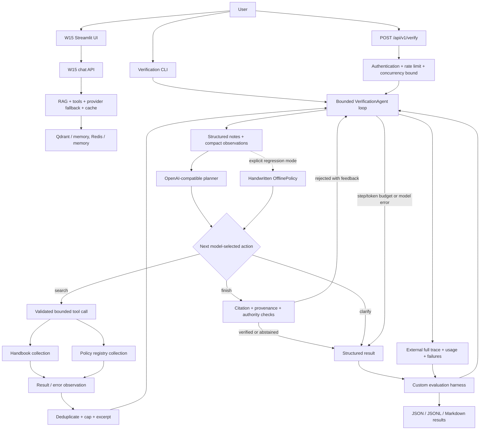

# W16 architecture

The model owns action choice and stopping proposals. Guards own evidence validation, source access, and budgets. Default bounds: eight model decisions, two documents per search, eight notes, 600 characters per excerpt, 30 seconds per model call, and five seconds per tool call. Model calls have no hidden retries. The 12,000-token threshold is checked before and after calls; the final response may cross it and is then stopped.

Each request has a fresh evidence ledger, notes, history, and trace. HTTP requests share only the stateless planner client/read-only corpus and a bounded concurrency semaphore. No raw chain-of-thought is requested: the trace records action JSON and a concise operational reason when the model supplies one. Abstention and clarification return fixed controller text, preserving unverified model prose only in the trace.
