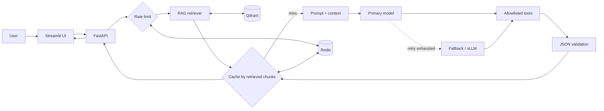

# Week 15 - Applied AI Systems

A complete solution for both assignment tasks: a retrieval-augmented AI assistant and a
production-oriented web application around it. The system combines a FastAPI backend,
Streamlit UI, OpenAI-compatible model providers, local vLLM support, Qdrant retrieval, Redis
caching/rate limiting, structured JSON responses, and allowlisted tools.

## What is implemented

| Assignment requirement | Implementation |
| --- | --- |
| Major LLM provider | Async OpenAI client with configurable model, base URL, temperature, and `top_p` |
| Structured output | JSON response mode, Pydantic validation, one repair attempt, and a validated degraded response |
| Tool calling | Model-native function calls for safe arithmetic, current time, and knowledge-base search |
| Document ingestion | UTF-8 text/Markdown/CSV/JSON/RST and PDF extraction, deterministic IDs, paragraph-aware overlapping chunks |
| Embeddings + vector DB | FastEmbed ONNX embeddings stored in Qdrant; deterministic offline embedder for tests |
| Local model | Optional GPU-backed vLLM service using Qwen2.5 through its OpenAI-compatible API |
| Web application | Streamlit chat, document upload, RAG toggle, health status, sources, and tool traces |
| Async/concurrent requests | Async FastAPI/provider/Redis I/O plus a bounded concurrent batch endpoint |
| Latency and throughput | Batched embeddings, one document upsert, cached generation results, bounded prompts/tool fan-out, thread offload for blocking clients, vLLM batching |
| Reliability | Exponential-backoff retry, primary/fallback routing, sliding-window rate limit, structured errors, graceful degradation |
| Containerization | Reproducible Docker image and Compose services for API, UI, Qdrant, Redis, and optional vLLM |
| Architecture diagram | Editable Mermaid diagram in [docs/architecture.md](docs/architecture.md) and [docs/architecture.mmd](docs/architecture.mmd) |

## Architecture



The detailed diagram documents both ingestion and online request paths, trust boundaries,
fallbacks, containers, concurrency, and shutdown behavior.

## Quick start with Docker

Requirements: Docker with Compose v2. An OpenAI API key is needed for the default cloud
provider. The first startup downloads the FastEmbed embedding model.

```bash
cd wk-15-applied-systems
cp .env.example .env
# Edit .env and set PRIMARY_API_KEY. Set APP_API_KEY too if the API will be exposed.
docker compose up --build
```

Open:

- Streamlit UI: <http://localhost:8501>
- Interactive API docs: <http://localhost:8000/docs>
- Health endpoint: <http://localhost:8000/health>

Ingest the bundled example from another terminal:

```bash
docker compose exec backend python scripts/ingest_sample.py \
  --backend http://localhost:8000 --session-id sample
```

Then use the API example below with session `sample`, or upload the sample document directly
in the UI before asking: `What is the refund window, and what information is required?`

Stop the stack with `docker compose down`. Add `--volumes` only when you intentionally want
to delete the locally persisted Qdrant and Redis data.

## Run locally without Docker

Install the locked Python environment:

```bash
uv sync
```

For an offline smoke run, use the deterministic demo model, in-memory vector store, and
offline hashing embedder. These modes exist for testing; they are not substitutes for the
configured production providers.

```bash
PRIMARY_PROVIDER=demo \
PRIMARY_MODEL=demo \
PRIMARY_BASE_URL=http://unused \
FALLBACK_PROVIDER= \
REDIS_URL= \
VECTOR_STORE=memory \
EMBEDDING_PROVIDER=hash \
MINIMUM_RELEVANCE_SCORE=-1 \
uv run uvicorn app.main:app --reload
```

In another terminal:

```bash
BACKEND_URL=http://localhost:8000 uv run streamlit run ui/streamlit_app.py
```

For a production-shaped local run, start Qdrant and Redis, then configure their URLs and a
real provider in `.env` before launching the API.

## Local vLLM deployment

The optional profile requires a supported NVIDIA GPU, NVIDIA Container Toolkit, enough GPU
memory for the selected model, and network access for the initial model download. Qwen2.5 is
configured with vLLM's Hermes tool-call parser.

```bash
PRIMARY_PROVIDER=vllm \
PRIMARY_MODEL=local-model \
PRIMARY_BASE_URL=http://vllm:8000/v1 \
PRIMARY_API_KEY=local-not-used \
FALLBACK_PROVIDER= \
docker compose --profile local-llm up --build
```

Change `VLLM_MODEL`, `VLLM_MAX_MODEL_LEN`, and `VLLM_GPU_MEMORY_UTILIZATION` in `.env` to fit
the available hardware. `VLLM_MODEL` accepts a Hugging Face model identifier. To use an
arbitrary host checkpoint path, add an explicit read-only bind mount to the `vllm` service and
set `VLLM_MODEL` to that path inside the container.

## API

### Ingest text

```bash
curl -X POST http://localhost:8000/api/v1/documents/text \
  -H 'Content-Type: application/json' \
  -H "X-API-Key: ${APP_API_KEY:-}" \
  -d '{"filename":"policy.md","text":"Refunds are available for 30 days.","session_id":"demo"}'
```

File upload uses `multipart/form-data` at `POST /api/v1/documents` with a field named `file`.
Supported extensions are `.pdf`, `.txt`, `.md`, `.rst`, `.csv`, and `.json`.

### Chat

```bash
curl -X POST http://localhost:8000/api/v1/chat \
  -H 'Content-Type: application/json' \
  -H "X-API-Key: ${APP_API_KEY:-}" \
  -d '{"message":"What is the refund window?","session_id":"demo","use_rag":true}'
```

Every successful reply conforms to this stable contract, even if the provider or retrieval
layer is degraded:

```json
{
  "answer": "Refunds are available for 30 days [source:1].",
  "confidence": 0.91,
  "follow_up_questions": [],
  "sources": [],
  "tool_calls": [],
  "provider": "openai/gpt-4.1-mini",
  "cached": false,
  "degraded": false,
  "request_id": "e9f...",
  "latency_ms": 412.7
}
```

Up to eight independent requests can be sent to `POST /api/v1/chat/batch` as
`{"requests": [...]}`. `BATCH_CONCURRENCY` bounds simultaneous provider calls.

Documents and retrieval are isolated by `session_id`; a chat can only retrieve documents
uploaded under the same value. `APP_API_KEY` enables shared-secret protection for every
write/chat endpoint. It is suitable for this local demonstration; use platform identity and
tenant-derived namespaces for a multi-user production service. Compose binds all published
ports to `127.0.0.1` by default.

## Reliability behavior

- Each provider call has a timeout and bounded exponential-backoff retry with jitter. The total
  deadline is divided across configured providers so a slow primary cannot consume the
  fallback's opportunity to run.
- After the primary retry budget is exhausted, the router tries the configured fallback;
  deterministic HTTP 4xx failures skip pointless same-provider retries.
- Redis implements shared TTL caching and an atomic weighted sliding-window rate limit. If Redis is
  unavailable at startup, both mechanisms fall back to concurrency-safe process memory.
- Retrieval failure sets `degraded=true` and continues without claiming the answer is
  grounded. Total provider failure returns a stable degraded JSON response.
- Request IDs appear in response bodies or headers, validation errors are bounded, uploads
  have a size cap, and tool names/arguments are allowlisted and validated.
- Retrieved documents are explicitly treated as untrusted evidence to reduce prompt-injection
  risk.
- RAG cache keys fingerprint the chunks actually retrieved, so a successful ingestion cannot
  revive a stale cached answer after a transient cache outage. Identical concurrent misses are
  collapsed before model generation.
- Initial prompts are capped by both characters and UTF-8 bytes, oldest history is dropped
  first, and model-driven tool rounds, calls, and result bytes are independently bounded.

## Model optimization and ONNX decision

The default generative model is accessed through a hosted API, so its weights are neither
available nor packaged here; exporting that remote model to ONNX is therefore not applicable.
The local generative path uses vLLM, whose continuous batching, optimized attention, and GPU
kernels are more appropriate for decoder LLM serving than a custom ONNX export. The embedding
model *does* run through ONNX Runtime via FastEmbed, giving the CPU-side RAG path an actual
portable inference optimization.

No fine-tuned checkpoint was included with the assignment PDF. If a checkpoint from a prior
session is vLLM-compatible, point `VLLM_MODEL` at that model or mounted path; the rest of the
API, UI, retry, caching, and retrieval stack remains unchanged.

## Tests and quality checks

```bash
uv run pytest
uv run ruff check .
uv run ruff format --check .
docker compose config --quiet
docker compose --profile local-llm config --quiet
```

The tests cover chunking/retrieval, safe tools, structured assistant responses, cache hits,
retry/fallback, Redis-compatible cache and rate-limit behavior, and the health/ingestion/chat/
batch API flow without network calls.

## Deployment guidance

For a cloud deployment:

1. Build and push the same application image used by `backend` and `ui`.
2. Deploy the API and UI as separate services with internal networking from UI to API.
3. Use managed Redis and Qdrant (or persistent private services) and inject their URLs through
   a secret manager; never bake credentials into the image.
4. Keep vLLM on a GPU node/service and expose it only to the backend. Scale the API separately
   from model workers.
5. Route backend liveness traffic to `/health` and UI liveness traffic to
   `/_stcore/health`; terminate TLS at the platform load balancer, restrict CORS, centralize
   logs by request ID, and alert on degraded responses and provider latency.
6. Run the test suite and a document-ingestion/chat smoke test before shifting production
   traffic.

At the ingress/reverse proxy, enforce a request-body limit no larger than the configured upload
policy as defense in depth. The app enforces its limit while consuming both fixed-length and
chunked bodies before form parsing, then separately caps processed file bytes and
post-extraction PDF pages, characters, and chunks.

The bonus cloud deployment itself is intentionally not performed because no cloud account,
target, or deployment credentials were supplied.

## Project layout

```text
app/                    FastAPI API and assistant orchestration
  assistant.py          RAG + model + tool loop + schema repair + cache
  providers.py          OpenAI/vLLM adapter, retry, and fallback router
  rag.py                loaders, chunking, embeddings, Qdrant/in-memory stores
  cache.py              Redis and in-memory TTL caches
  rate_limit.py         Redis and in-memory sliding-window limiters
  tools.py              validated allowlisted tools
ui/streamlit_app.py     web chat and document upload client
docs/architecture.*     detailed architecture diagram and explanation
sample_data/            small knowledge document for a smoke demo
scripts/ingest_sample.py sample ingestion client
tests/                  network-free unit and API tests
Dockerfile              reproducible non-root application image
docker-compose.yml      complete local stack and optional vLLM profile
```
